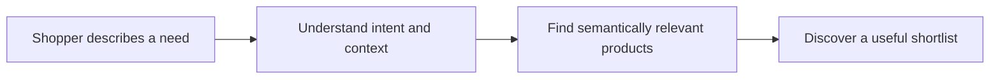

<!-- NexorAIQ – AI Commerce | GitHub profile README -->

<h1>NexorAIQ – AI Commerce</h1>

### Search every product in any language.

**AI-powered semantic search and multilingual product discovery for modern commerce.**

  
  
  
  

  
  
  

---

## About NexorAIQ

People rarely describe what they want using the exact words stored in a product catalogue. **NexorAIQ – AI Commerce** is focused on making commerce search more intuitive: shoppers can express their needs naturally, while AI-powered search helps connect intent with relevant products.

Our goal is simple: **less searching for the right words, more discovering the right products.**

## What we focus on

<table>
  <tr>
    <td width="50%" valign="top">
      <h3>Natural-language search</h3>
      Let shoppers describe needs, preferences, and use cases in everyday language—not only exact product names or keywords.
    </td>
    <td width="50%" valign="top">
      <h3>Semantic understanding</h3>
      Go beyond literal text matching by considering the meaning and context behind a search query.
    </td>
  </tr>
  <tr>
    <td width="50%" valign="top">
      <h3>Multilingual discovery</h3>
      Make product discovery more accessible to customers searching across languages.
    </td>
    <td width="50%" valign="top">
      <h3>Search relevance</h3>
      Keep relevance and product understanding at the centre of the e-commerce search experience.
    </td>
  </tr>
</table>

## Platform capabilities

NexorAIQ brings search intelligence, merchandising controls, and actionable analytics together so commerce teams can improve product discovery without relying only on exact keyword matches.

### [AI Copilot](https://www.nexoraiq.tech/features/ai-merchant-copilot)

Use Copilot as a conversational assistant for understanding what is happening in your store's search experience. Ask questions in natural language about popular searches, zero-result queries, search performance, product discovery, and potential opportunities. Copilot can summarize patterns, explain findings, and suggest next steps such as synonyms, query improvements, or product boosts. Where an action changes store behaviour, it should be presented for review and approval rather than silently applied.

### [Product Pinning](https://www.nexoraiq.tech/features/product-pinning)

Promote a specific product for a relevant search query by pinning it to a chosen position. Pinning helps merchants give priority to campaign products, best sellers, seasonal items, or strategic products when a shopper searches for selected terms. Use query targeting and position controls carefully so pinned results remain useful to shoppers; review the impact through search analytics.

### [Visual Merchandising](https://www.nexoraiq.tech/features/visual-merchandising)

Manage the promotional experience around search results with merchandising controls such as:

- **Hero banners and search banners** to highlight campaigns or relevant categories.
- **Promotional strips** to communicate offers and key messages.
- **Redirects** to send a query to a curated collection, category, or campaign destination when that is the most useful result.
- **Targeting and scheduling** by query, placement, priority, store or locale, and active dates where supported.
- **Creative management and measurement** to connect merchandising activity with engagement and downstream outcomes.

Merchandising should support the shopper's intent—not obscure relevant products. Review performance and attribution before extending a campaign.

### [Trending Search](https://www.nexoraiq.tech/features/trending-default)

Discover the terms shoppers are searching for and spot changes in demand. A trending-keywords view can help teams identify high-volume searches, rising queries, repeated searches, and queries that return few or no useful results. Use these insights to plan campaigns, improve product data, add synonyms, tune ranking, and identify unmet catalogue demand. Trends should be interpreted alongside clicks, conversions, and zero-result rates rather than search volume alone.

### [AI Autocomplete](https://www.nexoraiq.tech/features/ai-autocomplete)

- **Natural-language understanding:** interpret the intent behind a shopper's query, not only exact words.
- **Semantic relevance:** connect related concepts and product attributes even when catalogue wording differs from the query.
- **Multilingual discovery:** help shoppers search across supported languages and express needs in the language that feels natural to them.
- **Query refinement:** improve the handling of synonyms, alternate wording, and common search gaps.
- **Product ranking and relevance:** combine query understanding with catalogue information to surface useful results.

### [Search Rules & Boosts](https://www.nexoraiq.tech/features/search-rules-boosts)

Give commerce teams visibility into query patterns, zero-result searches, search engagement, and product discovery. Use these signals to prioritise improvements, test relevance changes, and evaluate whether ranking or merchandising adjustments are helping. Where AI optimisation, experiments, approval controls, or rollback are enabled for a workspace, use them to test changes deliberately and retain human oversight over consequential updates.

### The broader NexorAIQ workspace

The platform is intended to bring together store connection, catalogue ingestion and indexing, search configuration, relevance and merchandising controls, Copilot assistance, analytics, and subscription management. Available controls may vary by commerce integration and subscription plan.

## Solutions

NexorAIQ supports industry-specific product discovery, different commerce operating models, enterprise trust, and measurable search performance.

### Solutions by industry

- **[Fashion & Apparel](https://www.nexoraiq.tech/solutions/fashion-apparel):** Visual style matching, colour and size facets, and trend boosting.
- **[Beauty & Cosmetics](https://www.nexoraiq.tech/solutions/beauty-cosmetics):** Skin-tone filtering, routine building, and ingredient discovery.
- **[Electronics & Tech](https://www.nexoraiq.tech/solutions/electronics-tech):** Exact part-number search, specification matrices, and compatibility discovery.
- **[Luxury & High-Catalogue Retail](https://www.nexoraiq.tech/solutions/luxury-high-catalog):** Curated product discovery, margin protection, and brand-aware boosting.

### Solutions by business model

- **[Multi-Vendor Marketplaces](https://www.nexoraiq.tech/solutions/multi-vendor-marketplaces):** Vendor-aware ranking, cross-seller discovery, and marketplace scale.
- **[B2B Wholesale & Commerce](https://www.nexoraiq.tech/solutions/b2b-wholesale):** Contract price tiers, bulk order lists, and scoped catalogues.
- **[Enterprise D2C Brands](https://www.nexoraiq.tech/solutions/enterprise-d2c):** Headless GraphQL experiences, fast edge search, and omnichannel synchronisation.
- **[Omnichannel Retail Chains](https://www.nexoraiq.tech/solutions/omnichannel-retail):** Store availability, buy online/pick up in store (BOPIS), and point-of-sale inventory synchronisation.

### Customer proof, ROI & enterprise trust

- **[Customer Case Studies](https://www.nexoraiq.tech/customers):** Explore customer stories and reported outcomes.
- **[Security & Compliance](https://www.nexoraiq.tech/security):** Learn about enterprise security, data privacy, and trust practices.
- **[Search ROI Benchmarks](https://www.nexoraiq.tech/benchmarks):** Review search revenue benchmarks and performance measures.
- **[Zero-Downtime Migration](https://www.nexoraiq.tech/migration):** Explore migration planning and approaches designed to minimise disruption.

### Search Revenue Lift Simulator

Estimate potential revenue impact using the [Search ROI Benchmarks](https://www.nexoraiq.tech/benchmarks) resource. Actual results vary by store, catalogue, traffic, and search experience; validate projections with your own data.

## Getting started: installation, login, and onboarding

For a Shopify store, the intended first-run journey is:

1. **Install NexorAIQ** from the Shopify App Store and approve the requested Shopify permissions.
2. **Open the app inside Shopify Admin** from **Apps → NexorAIQ**. This is the entry point for login/session access and setup; merchants should not need to begin by searching for a separate public dashboard URL.
3. **Complete the onboarding/setup flow** in the NexorAIQ app. Connect or confirm the store, review the connection status, and complete any requested setup details.
4. **Choose or approve a subscription** on the Shopify-managed pricing/approval screen, if prompted. The subscription status must be confirmed before paid features or plan limits are treated as active.
5. **Import and index the catalogue.** Wait for the initial sync/indexing to complete, then test real customer queries and review the search results.
6. **Configure search and merchandising.** Review relevance, pin or promote selected products, inspect trending queries, and use Copilot/analytics to find improvements.

If the store was already connected or the initial setup was interrupted, reopen **Shopify Admin → Apps → NexorAIQ** and look for the onboarding/setup or connection status screen. Exact labels may vary as the app UI evolves.

### Pricing plans and free trial

The public pricing page presents the following monthly prices. The INR (India) values are listed first, followed by the USD (Global) values. Starter, Growth, and Professional include a 14-day free trial. The page also offers monthly/yearly billing with a “Save 15%” yearly option.

| Plan | Monthly price (INR India, then USD Global) | Trial | Monthly search allowance | Product limit | Seats | Included features shown |
| --- | ---: | --- | ---: | ---: | ---: | --- |
| Starter | ₹6,999/month · $99/month | 14 days | 100K searches/month | 5,000 products | 2 seats | AI search, email support |
| Growth | ₹9,999/month · $149/month | 14 days | 1M searches/month | 30,000 products | 5 seats | AI search, email support |
| Professional | ₹19,999/month · $299/month | 14 days | 15M searches/month | 100,000 products | 10 seats | AI search, priority support |
| Enterprise | Custom · Custom | No trial shown in the supplied pricing view | Custom | Custom | Custom | Dedicated database hosting, custom domain support |

**Yearly billing:** the pricing page displays a 15% saving for yearly billing. The figures above are monthly prices; yearly billed amounts should be read from the live pricing selector rather than guessed.

#### What the 14-day trial means

The pricing page advertises a 14-day free trial for Starter, Growth, and Professional. Use the [Pricing page](https://www.nexoraiq.tech/pricing) to choose a plan and follow the live signup/subscription flow. The supplied screenshot does not specify whether a payment method is required, the exact billing start date, or cancellation terms; review the terms shown during signup before confirming.

#### Onboarding

This repository contains README documentation, not the product's application code, so it cannot verify every in-app onboarding screen. Follow the live signup flow for current steps. For a guided walkthrough, use [Book a Demo](https://www.nexoraiq.tech/book-demo).

### Where to find the main tools

- **Onboarding / Store connection:** Shopify Admin → Apps → NexorAIQ; complete the setup prompts and confirm connection status.
- **Search configuration:** NexorAIQ app workspace, in the search/relevance configuration area.
- **Pinning and merchandising:** the search merchandising controls, where query targeting, product placement, creative, and scheduling options are available.
- **Trending keywords and analytics:** the analytics/search insights area.
- **Copilot:** the Copilot assistant within the NexorAIQ workspace, when enabled for the store and plan.
- **Plan and billing:** the Shopify-managed subscription approval flow and the store's app subscription details.

These are functional navigation descriptions; use the labels visible in the currently deployed app if they differ.

## How product discovery works

## Built for commerce

- **Shoppers:** search naturally and discover products that better match the need behind a query.
- **Merchants:** make product catalogues easier for customers to explore.
- **Commerce teams:** make search relevance and product discovery a meaningful part of the customer experience.

## Explore NexorAIQ

  <a href="https://www.nexoraiq.tech/"><strong>Official Website</strong></a>
  &nbsp; · &nbsp;
  <a href="https://www.nexoraiq.tech/pricing"><strong>View Pricing & Start Trial</strong></a>
  &nbsp; · &nbsp;
  <a href="https://www.nexoraiq.tech/book-demo"><strong>Book a Demo</strong></a>
  &nbsp; · &nbsp;
  <a href="https://www.nexoraiq.tech/artworks/index.html"><strong>Brand & Product Artwork</strong></a>
  &nbsp; · &nbsp;
  <a href="https://github.com/nexoraiq-tech"><strong>GitHub Organization</strong></a>

## Our vision

Search should understand more than a string of keywords. It should account for what a shopper is trying to find and help surface relevant products across languages and shopping journeys.

  <h3>NexorAIQ – AI Commerce</h3>
  
<em>Search every product in any language.</em>

  <a href="https://www.nexoraiq.tech/">nexoraiq.tech</a>

