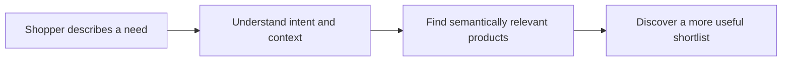

<!-- NexorAIQ GitHub profile README -->

  

  <h1>NexorAIQ</h1>
  <h3>Search every product in any language.</h3>
  
<strong>AI-powered semantic search & product discovery for modern commerce.</strong>

  

    <a href="https://www.nexoraiq.tech/"><strong>Explore the website</strong></a>
    &nbsp; · &nbsp;
    <a href="https://www.nexoraiq.tech/artworks/index.html">Brand & product artwork</a>
    &nbsp; · &nbsp;
    <a href="https://www.linkedin.com/showcase/nexoraiqtech/">LinkedIn</a>
  

---

## Make product discovery feel effortless

People rarely describe what they want using the exact words stored in a product catalogue. NexorAIQ is focused on making commerce search more intuitive: shoppers can express their needs naturally, while AI-powered search helps connect intent with relevant products.

The goal is simple: **less searching for the right words, more discovering the right products.**

## What NexorAIQ focuses on

<table>
  <tr>
    <td width="50%" valign="top">
      <h3>Natural-language search</h3>
      Let shoppers describe needs, preferences, and use cases in everyday language—not only exact product names or keywords.
    </td>
    <td width="50%" valign="top">
      <h3>Semantic understanding</h3>
      Go beyond literal text matching by considering the meaning and context behind a search query.
    </td>
  </tr>
  <tr>
    <td width="50%" valign="top">
      <h3>Multilingual discovery</h3>
      Make product discovery more accessible to customers searching across languages.
    </td>
    <td width="50%" valign="top">
      <h3>Search relevance</h3>
      Keep relevance and product understanding at the centre of the e-commerce search experience.
    </td>
  </tr>
</table>

## The product discovery journey

The experience we are working toward connects a shopper's intent with useful product results:

## Designed around commerce

- **For shoppers:** search naturally and discover products that better match the need behind a query.
- **For merchants:** make product catalogues easier for customers to explore.
- **For commerce teams:** treat search relevance and product discovery as important parts of the customer experience.

## Explore NexorAIQ

| Resource | Visit |
| --- | --- |
| Official website | [nexoraiq.tech](https://www.nexoraiq.tech/) |
| Brand and product artwork | [Open the artwork gallery](https://www.nexoraiq.tech/artworks/index.html) |
| LinkedIn showcase | [NexorAIQ — AI Commerce Search](https://www.linkedin.com/showcase/nexoraiqtech/) |
| GitHub profile | [@nexoraiq-tech](https://github.com/nexoraiq-tech) |

## Our point of view

Search should understand more than a string of keywords. It should account for what a shopper is trying to find and help surface relevant products across languages and shopping journeys.

**NexorAIQ — AI Commerce Search.**

  
Discover the vision at <a href="https://www.nexoraiq.tech/">nexoraiq.tech</a>.

