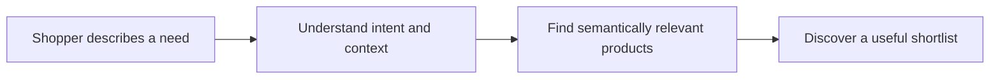

<!-- NexorAIQ – AI Commerce | GitHub profile README -->

<h1>NexorAIQ – AI Commerce</h1>

### Search every product in any language.

**AI-powered semantic search and multilingual product discovery for modern commerce.**

  
  

  
  
  

---

## About NexorAIQ

People rarely describe what they want using the exact words stored in a product catalogue. **NexorAIQ – AI Commerce** is focused on making commerce search more intuitive: shoppers can express their needs naturally, while AI-powered search helps connect intent with relevant products.

Our goal is simple: **less searching for the right words, more discovering the right products.**

## What we focus on

<table>
  <tr>
    <td width="50%" valign="top">
      <h3>Natural-language search</h3>
      Let shoppers describe needs, preferences, and use cases in everyday language—not only exact product names or keywords.
    </td>
    <td width="50%" valign="top">
      <h3>Semantic understanding</h3>
      Go beyond literal text matching by considering the meaning and context behind a search query.
    </td>
  </tr>
  <tr>
    <td width="50%" valign="top">
      <h3>Multilingual discovery</h3>
      Make product discovery more accessible to customers searching across languages.
    </td>
    <td width="50%" valign="top">
      <h3>Search relevance</h3>
      Keep relevance and product understanding at the centre of the e-commerce search experience.
    </td>
  </tr>
</table>

## How product discovery works

## Built for commerce

- **Shoppers:** search naturally and discover products that better match the need behind a query.
- **Merchants:** make product catalogues easier for customers to explore.
- **Commerce teams:** make search relevance and product discovery a meaningful part of the customer experience.

## Explore NexorAIQ

  <a href="https://www.nexoraiq.tech/"><strong>Official Website</strong></a>
  &nbsp; · &nbsp;
  <a href="https://www.nexoraiq.tech/artworks/index.html"><strong>Brand & Product Artwork</strong></a>
  &nbsp; · &nbsp;
  <a href="https://github.com/nexoraiq-tech"><strong>GitHub</strong></a>

## Our vision

Search should understand more than a string of keywords. It should account for what a shopper is trying to find and help surface relevant products across languages and shopping journeys.

  <h3>NexorAIQ – AI Commerce</h3>
  
<em>Search every product in any language.</em>

  <a href="https://www.nexoraiq.tech/">nexoraiq.tech</a>

