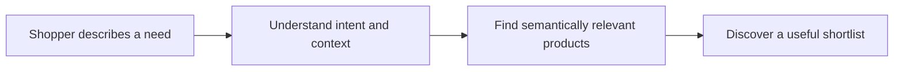

<!-- NexorAIQ – AI Commerce | GitHub profile README -->

<h1>NexorAIQ – AI Commerce</h1>

### Search every product in any language.

**AI-powered semantic search and multilingual product discovery for modern commerce.**

  
  
  
  

  
  
  

---

## About NexorAIQ

People rarely describe what they want using the exact words stored in a product catalogue. **NexorAIQ – AI Commerce** is focused on making commerce search more intuitive: shoppers can express their needs naturally, while AI-powered search helps connect intent with relevant products.

Our goal is simple: **less searching for the right words, more discovering the right products.**

## What we focus on

<table>
  <tr>
    <td width="50%" valign="top">
      <h3>Natural-language search</h3>
      Let shoppers describe needs, preferences, and use cases in everyday language—not only exact product names or keywords.
    </td>
    <td width="50%" valign="top">
      <h3>Semantic understanding</h3>
      Go beyond literal text matching by considering the meaning and context behind a search query.
    </td>
  </tr>
  <tr>
    <td width="50%" valign="top">
      <h3>Multilingual discovery</h3>
      Make product discovery more accessible to customers searching across languages.
    </td>
    <td width="50%" valign="top">
      <h3>Search relevance</h3>
      Keep relevance and product understanding at the centre of the e-commerce search experience.
    </td>
  </tr>
</table>

## Platform capabilities

NexorAIQ brings search intelligence, merchandising controls, and actionable analytics together so commerce teams can improve product discovery without relying only on exact keyword matches.

### [AI Copilot](https://www.nexoraiq.tech/features/ai-merchant-copilot)

Use Copilot as a conversational assistant for understanding what is happening in your store's search experience. Ask questions in natural language about popular searches, zero-result queries, search performance, product discovery, and potential opportunities. Copilot can summarize patterns, explain findings, and suggest next steps such as synonyms, query improvements, or product boosts. Where an action changes store behaviour, it should be presented for review and approval rather than silently applied.

### [Pin product](https://www.nexoraiq.tech/#pin-product)

Promote a specific product for a relevant search query by pinning it to a chosen position. Pinning helps merchants give priority to campaign products, best sellers, seasonal items, or strategic products when a shopper searches for selected terms. Use query targeting and position controls carefully so pinned results remain useful to shoppers; review the impact through search analytics.

### [Search merchandising](https://www.nexoraiq.tech/#search-merchandising)

Manage the promotional experience around search results with merchandising controls such as:

- **Hero banners and search banners** to highlight campaigns or relevant categories.
- **Promotional strips** to communicate offers and key messages.
- **Redirects** to send a query to a curated collection, category, or campaign destination when that is the most useful result.
- **Targeting and scheduling** by query, placement, priority, store or locale, and active dates where supported.
- **Creative management and measurement** to connect merchandising activity with engagement and downstream outcomes.

Merchandising should support the shopper's intent—not obscure relevant products. Review performance and attribution before extending a campaign.

### [Trending search keywords](https://www.nexoraiq.tech/#trending-search-keywords)

Discover the terms shoppers are searching for and spot changes in demand. A trending-keywords view can help teams identify high-volume searches, rising queries, repeated searches, and queries that return few or no useful results. Use these insights to plan campaigns, improve product data, add synonyms, tune ranking, and identify unmet catalogue demand. Trends should be interpreted alongside clicks, conversions, and zero-result rates rather than search volume alone.

### [Semantic and multilingual search](https://www.nexoraiq.tech/#semantic-multilingual-search)

- **Natural-language understanding:** interpret the intent behind a shopper's query, not only exact words.
- **Semantic relevance:** connect related concepts and product attributes even when catalogue wording differs from the query.
- **Multilingual discovery:** help shoppers search across supported languages and express needs in the language that feels natural to them.
- **Query refinement:** improve the handling of synonyms, alternate wording, and common search gaps.
- **Product ranking and relevance:** combine query understanding with catalogue information to surface useful results.

### [Search analytics and AI optimisation](https://www.nexoraiq.tech/#search-analytics-ai-optimisation)

Give commerce teams visibility into query patterns, zero-result searches, search engagement, and product discovery. Use these signals to prioritise improvements, test relevance changes, and evaluate whether ranking or merchandising adjustments are helping. Where AI optimisation, experiments, approval controls, or rollback are enabled for a workspace, use them to test changes deliberately and retain human oversight over consequential updates.

### The broader NexorAIQ workspace

The platform is intended to bring together store connection, catalogue ingestion and indexing, search configuration, relevance and merchandising controls, Copilot assistance, analytics, and subscription management. Available controls may vary by commerce integration and subscription plan.

## Getting started: installation, login, and onboarding

For a Shopify store, the intended first-run journey is:

1. **Install NexorAIQ** from the Shopify App Store and approve the requested Shopify permissions.
2. **Open the app inside Shopify Admin** from **Apps → NexorAIQ**. This is the entry point for login/session access and setup; merchants should not need to begin by searching for a separate public dashboard URL.
3. **Complete the onboarding/setup flow** in the NexorAIQ app. Connect or confirm the store, review the connection status, and complete any requested setup details.
4. **Choose or approve a subscription** on the Shopify-managed pricing/approval screen, if prompted. The subscription status must be confirmed before paid features or plan limits are treated as active.
5. **Import and index the catalogue.** Wait for the initial sync/indexing to complete, then test real customer queries and review the search results.
6. **Configure search and merchandising.** Review relevance, pin or promote selected products, inspect trending queries, and use Copilot/analytics to find improvements.

If the store was already connected or the initial setup was interrupted, reopen **Shopify Admin → Apps → NexorAIQ** and look for the onboarding/setup or connection status screen. Exact labels may vary as the app UI evolves.

### Pricing plans and 14-day free trial

**Trial offer:** NexorAIQ's intended offer is a 14-day free trial for eligible Shopify merchants. Merchants should be able to install the app and approve a Shopify-managed subscription to begin the trial. The Shopify billing screen must show the trial duration, plan price, billing cadence, and the date paid billing starts before the merchant confirms.

During the 14-day trial, the onboarding experience should guide a merchant through:

1. Installing NexorAIQ from the Shopify App Store and opening it in **Shopify Admin → Apps → NexorAIQ**.
2. Connecting the store and checking the connection status.
3. Importing and indexing the product catalogue.
4. Testing search with natural-language and multilingual queries.
5. Reviewing search analytics, trending queries, and zero-result searches.
6. Trying available Copilot, product pinning, and merchandising tools for the selected plan.
7. Reviewing the plan and billing details before the trial ends.

**Important implementation status:** this GitHub profile repository contains documentation only; it does not contain the Shopify app's billing or subscription code. Adding a 14-day-trial description here does **not** activate the trial. To make the offer available to every eligible merchant, configure the 14-day trial on the Shopify App Store / Partner Dashboard pricing plan and ensure the app's subscription flow uses that plan. Verify the published listing and in-app billing approval screen before announcing the trial as live.

#### Proposed pricing model

The following figures are planning estimates only; they are not verified live prices:

| Proposed plan | Indicative India price | Approx. USD equivalent | Intended fit |
| --- | ---: | ---: | --- |
| Starter | ₹6,999/month | **$75/month** | Smaller stores getting started with enhanced search and core discovery tools |
| Growth | ₹9,999/month | **$105/month** | Growing catalogues needing deeper search insights and merchandising workflows |
| Professional | ₹19,999/month | **$210/month** | Larger or more advanced stores requiring broader optimisation and analytics capabilities |

USD figures are rounded planning estimates based on an illustrative exchange rate of approximately **₹95.2 per US$1** (27 October 2026), not fixed currency conversions. Actual conversion rates, bank fees, taxes, Shopify billing rules, and any regional pricing strategy may change the final amount.

**Before publishing prices as current prices, confirm both currencies against the live Shopify App Store listing and the app's billing configuration.** The same applies to feature entitlements, usage limits, billing cadence, and regional pricing.

#### Book a demo

Merchants who want a guided walkthrough should use the **Book a Demo** link at the top of this README and on the NexorAIQ website. The link currently points to the website's demo section; confirm that the live page contains a working booking form or calendar before launch.

### Where to find the main tools

- **Onboarding / Store connection:** Shopify Admin → Apps → NexorAIQ; complete the setup prompts and confirm connection status.
- **Search configuration:** NexorAIQ app workspace, in the search/relevance configuration area.
- **Pinning and merchandising:** the search merchandising controls, where query targeting, product placement, creative, and scheduling options are available.
- **Trending keywords and analytics:** the analytics/search insights area.
- **Copilot:** the Copilot assistant within the NexorAIQ workspace, when enabled for the store and plan.
- **Plan and billing:** the Shopify-managed subscription approval flow and the store's app subscription details.

These are functional navigation descriptions; use the labels visible in the currently deployed app if they differ.

## How product discovery works

## Built for commerce

- **Shoppers:** search naturally and discover products that better match the need behind a query.
- **Merchants:** make product catalogues easier for customers to explore.
- **Commerce teams:** make search relevance and product discovery a meaningful part of the customer experience.

## Explore NexorAIQ

  <a href="https://www.nexoraiq.tech/"><strong>Official Website</strong></a>
  &nbsp; · &nbsp;
  <a href="https://www.nexoraiq.tech/"><strong>Start 14-Day Trial</strong></a>
  &nbsp; · &nbsp;
  <a href="https://www.nexoraiq.tech/book-demo"><strong>Book a Demo</strong></a>
  &nbsp; · &nbsp;
  <a href="https://www.nexoraiq.tech/artworks/index.html"><strong>Brand & Product Artwork</strong></a>
  &nbsp; · &nbsp;
  <a href="https://github.com/nexoraiq-tech"><strong>GitHub Organization</strong></a>

## Our vision

Search should understand more than a string of keywords. It should account for what a shopper is trying to find and help surface relevant products across languages and shopping journeys.

  <h3>NexorAIQ – AI Commerce</h3>
  
<em>Search every product in any language.</em>

  <a href="https://www.nexoraiq.tech/">nexoraiq.tech</a>

